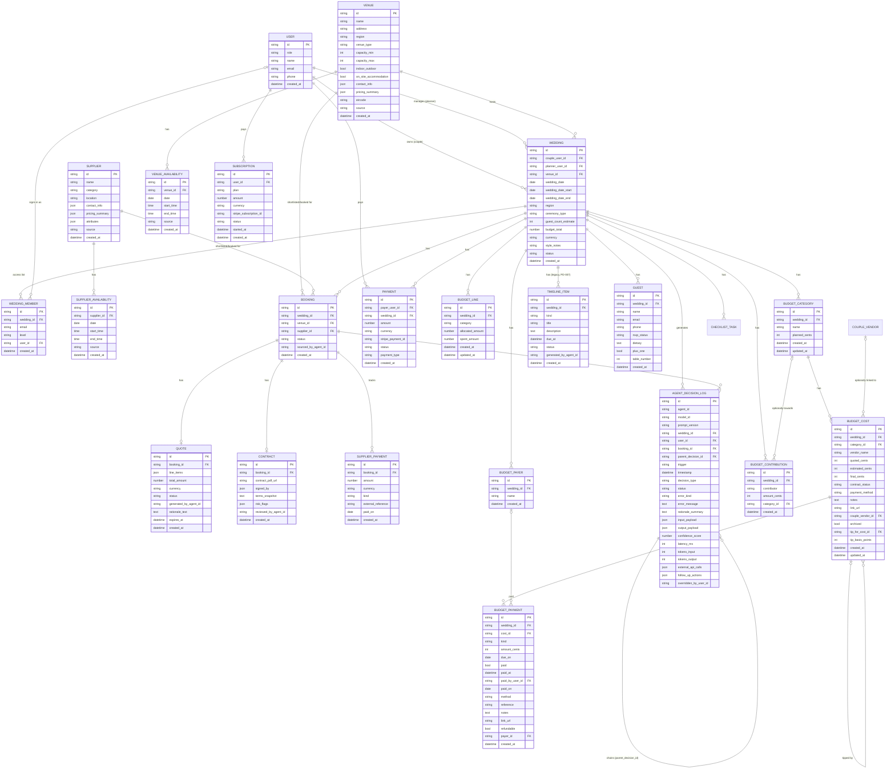

# VenueFlow — ERD & Data Model (MVP, AI Wedding Coordinator)

This model supports the AI Wedding Coordinator product (see [CLAUDE.md](../CLAUDE.md)). The agent does what a human wedding planner does: source venues + suppliers, draft timelines, track budget, review contracts, manage RSVPs/seating, and run day-of logistics. Customers are **couples** (one-time coordinator fee per wedding) and **independent wedding planners** (monthly subscription, manage multiple client weddings).

## Entities

### Identity & billing

- **WeddingMember** — the access list (PD-002). One row per wedding and email (unique together); `level` ∈ `{viewer, editor, owner}`. `user_id` is filled in when that person first signs in with a verified email. The wedding's creator is added as owner. Migration `0002` also backfills each existing `couple_user_id` as owner.
- **User** — `role` is `couple` for everyone since PD-003 (the planner and admin roles were removed; older rows may still hold them, and the API ignores role for access). The old `venue_admin` role is removed: VenueFlow is not sold to venues.
- **Subscription** — *unused since PD-003, table kept empty.* Recurring billing for planners (€199–€499/mo plans). One active subscription per planner user.
- **Payment** — *unused since PD-003, table kept empty.* One-time charges VenueFlow collected via Stripe. `payment_type` ∈ `{coordinator_fee, planner_setup, other}`. Coordinator fees (couples, €299–€999) are the primary one-time revenue stream.

### Core wedding object

- **Wedding** — the central object. `couple_user_id` required; `planner_user_id` optional (set when a planner manages it). `venue_id` is a denormalized convenience FK to the chosen venue — it mirrors the Booking with `venue_id IS NOT NULL AND status='booked'`. `status` ∈ `{intake, planning, booked, completed, cancelled}` (intake = being planned by the agent, planning = budget and timeline ready, booked = venue locked; PD-003 removed the payment stage). `wedding_date` is nullable; if not set, planning uses the date range defined by `wedding_date_start` and `wedding_date_end`. `region` specifies the target wedding location. `ceremony_type` determines the cultural budgeting and timeline template.
- **BudgetLine** — one row per category per wedding (`venue, catering, florals, photography, videography, music, dj, officiant, stationery, hair_makeup, transport, cake, other`). Legacy (float EUR): the intake planner stopped creating these in B42, and existing rows are kept. Since B44 nothing in the app reads or writes them except the old `GET /weddings/{id}/budget` route, which the screens no longer call: the vendor cards, matchers, quote extractor, concierge and Dashboard read the couple's own budget (PD-004) instead, and the extractor no longer updates `spent_amount`.
- **Budget (PD-004)** — the couple's own budget screen, separate from the intake planner's legacy `BudgetLine` rows (float EUR amounts, no longer created; see above). Every amount is whole US cents. `Wedding.budget_total_cents` is the couple's optional total (blank until they set it; not taken from the intake `budget_total`). The setup form (PD-009) sets it when the couple give a budget there, and also fills the legacy `budget_total` float with the same amount for the older agents. `budget_total` is nullable since migration 0005: a budget left blank is stored as blank, never 0. **BudgetCategory** has a name, optional `planned_cents`, and an optional `sort_order` (B67, migration `0010`): the couple's order on the Budget screen, lowest first; the app numbers every category it adds (new ones go last), and one without a number goes last in the order it was added. `0010` numbered existing categories in the order they were added, as a data step. `PUT /budget/categories/order` takes every one of the wedding's category ids once, or refuses. **BudgetCost** is an expense under a category: free-text `vendor_name`, optional `estimated_cents`, `quoted_cents` and `final_cents`, `contract_status` ∈ `{none, sent, signed}` (default `none`, set only by the couple, rule 4), an optional `payment_method`, `notes` and `link_url` (http or https only, for example a file in Google Drive, PD-013 call a), an optional `couple_vendor_id` linking it to a vendor on the Vendors page (`ON DELETE SET NULL`), and `archived` (kept and listed, but left out of every total and the payments due). **BudgetPayment** is a deposit or later payment on a cost, with an optional `due_on`, `method`, `reference`, `notes` and `link_url`; `refundable` marks a refundable security deposit, which is tracked but is not part of the cost and never counts as paid toward it. `paid`, `paid_at` and `paid_by_user_id` change only when a signed-in owner or editor ticks it (rule 4); `paid_on` is the day the couple say they paid, set only on a paid payment and cleared when it's unticked. Migration `0009` (B65) added these columns and, as a one-time data step, the Wildman BT expense ($12,000 quoted, contract `none`) with its three unpaid payments from the draft contract, under the wedding's existing venue category or a new "Venue & Catering" one. **BudgetPayer** (B76, PD-016, migration `0012`) is a name on the wedding's "People who pay" list, typed by the couple in the app so real names never enter code; `BudgetPayment.payer_id` (optional, `ON DELETE SET NULL`) records who paid or will pay each payment. It's separate from `paid_by_user_id` (who ticked it) and never changes `paid`. The API refuses to remove a payer named on any payment, so a record of who paid isn't lost by accident; renaming is fine. `0012` has no data step: the list starts empty and existing payments have no payer. A **tip** (B79, PD-017, migration `0013`) is a BudgetCost with `tip_for_cost_id` set (`ON DELETE SET NULL`), the expense it's for: named "Tip: <expense>", in the same category, and counted like any expense. `tip_basis_points` (hundredths of a percent) marks a percentage tip; it's blank for a tip typed in dollars, whose amount is `final_cents`. A percentage tip's amount is worked out on read from the linked expense's actual, else quote, else estimate (never its payments), in integer cents rounded half up; with none of those it waits at 0. While any payment on the tip is ticked paid, its amount is the `final_cents` saved when the first was ticked, so a paid tip doesn't move; unticking or removing the last paid one clears it and the tip follows again. Payments are stored as typed, with one exception (PD-018, no schema change): when a percentage tip's amount changes because its expense's cost or its percentage changes, a tip whose only payment is unpaid, not refundable and exactly what the tip came to just before the change has that payment set to the new amount in the same transaction; a tip waiting for a cost, an archived tip, and unticking a paid payment all leave it as typed. A tip can be renamed (`PATCH /budget/tips/{id}` takes `vendor_name`); renaming its expense then leaves the tip's own name alone. A tip can't be for another tip. Moving or renaming an expense moves and renames its tips. Archiving or removing an expense with tips is refused unless `?tips=remove` (archive them too, or delete them and their payments) or `?tips=keep` (clear the link and the percentage, keeping the current dollar figure in `final_cents`). `0013` has no data step: existing expenses stay plain lines. `POST /budget/categories/{id}/costs` may carry a `first_payment` (type, amount, due date, payer) that is saved with the expense in the same commit, or neither is saved. The couple see `final_cents` as "Actual cost" and one "Estimate or quote" box, which shows `quoted_cents` if set, else `estimated_cents`, and writes back to that same column, so an older estimate under a quote stays stored. **BudgetContribution** records who is contributing (a free-text label) and how much, optionally towards one category. "Committed" for a cost is its final cost, else its quote, else its estimate, else the sum of its non-refundable payments; "paid" is the ticked non-refundable payments; "still to pay" is committed minus paid, never below 0, with any excess shown as overpaid per expense. Each expense's status is `unpaid`, `partly_paid`, `paid` or `overdue` (an unpaid payment due before today in Chicago, B45). All of these are worked out on read (`app/utils/budget_math.py`), never stored. The dashboard (B66, PD-013 step 2) adds more read-only figures with no schema change: each category's status against its `planned_cents` target (`no_target`, `within`, `near_limit` at 90% or more, `over`), its share of the total, what's left of the target, and for the whole budget what's left of or over the total, how much of the total is shared out, paid toward the cost (each expense counted only up to its cost), and counts of expenses, upcoming and overdue payments. A blank total is "not set", never 0. The contingency category is the first one named "Contingency" (case, spaces and underscores ignored); the couple add it themselves. `POST /budget/move` moves an amount from one category's target to another's with two conditional UPDATEs in one transaction, so neither changes unless both can, and a target never goes below 0 (a blank target counts as 0). Removing a category never removes money records (B67): one with expenses (archived ones included) is refused unless `move_to` names another of the wedding's categories, and then its expenses move there with their payments and ticks unchanged; contributions towards it stay, untied. The suggested categories (PD-013 call b: the nine groups from the owner's brief plus Contingency, with Venue & Catering split into Venue and Food & Drink by PD-015, eleven in all) and each one's one-tap expense ideas are a code constant (`app/utils/budget_defaults.py`), not tables; there's no separate group table, because each group is a category. `POST /budget/categories/defaults` adds the ones the couple don't have, on their click, after their own and with no target; a category with the same name (case, spaces, underscores and "&"/"and" ignored; "Venues" and the old "Venue & Catering" count as Venue) is left as it is. A removed suggestion stored under the old name "Venue & Catering" counts as removed Venue; Food & Drink isn't removed by it. `Wedding.declined_budget_defaults` (B71, migration `0011`, optional JSON list of suggested names, blank means none) records the suggested categories the couple removed: deleting a category that matches a suggestion (by the same name rule; only when no look-alike twin is left) adds it, and the overview then leaves it out of `missing_default_categories` and lists it in `removed_default_categories`. Renaming a suggested category isn't a removal. Adding a category with that name again, by hand or by naming it in `POST /budget/categories/defaults`, clears it; that call with no names adds every missing suggestion except the removed ones. `POST /budget/categories/defaults/restore` (owners and editors) clears all of them, or the ones named, so they're offered again; it adds no category. `POST /budget/costs/{id}/duplicate` copies an expense's typed fields into the same category as "<name> (copy)", with no payments, contract `none` and not archived. Each expense's `next_due_on` (its soonest unpaid due date) is worked out on read for the list of all expenses. A vendor card compares its latest quote with the `planned_cents` of the category whose name matches the vendor's catalogue category (case, spaces and underscores ignored), and only when the quote is in USD; otherwise it shows no over/within flag (`app/utils/budget_compare.py`, B42).
- **TimelineItem** — *legacy since PD-007.* The intake planner no longer writes it. The one-off checklist import (`manage_checklist.py`, or "Load my checklist" in the app, PD-011) merges each wedding's rows into the checklist (into the stage nearest `due_at`, skipping titles already on it), checks every row is accounted for, then deletes them. The table stays until a later migration drops it. `kind` ∈ `{planning, day_of}`. Planning items have a future `due_at`; day-of items use the wedding date + time-of-day. One table to keep the agent's "draft + update timeline" decisions uniform.
- **ChecklistTask (PD-007)** — one shared planning checklist per wedding. `stage` is a key from `app/utils/checklist.py` (`12m` … `day`, `post`); due dates aren't stored but worked out from `Wedding.wedding_date` on every read. `position` orders tasks within a stage. `done`, `done_at` and `done_by_user_id` change only when an owner or editor ticks it; ticking touches nothing else (rule 4). `source` ∈ `{owner_list, tradition, ai_timeline, couple}` (the Wildman BT payment tasks, `source_ref` `V1`–`V3`, are `owner_list`: the owner asked for them, PD-011); `source_ref` (unique per wedding) names where an imported task came from, so the import can't add it twice. `Wedding.wedding_date_set_on` is the day the date was last set: stages already past on that day form the "Catch up" group. `Wedding.checklist_imported_at` makes the import run once. `Wedding.wedding_date_confirmed` (B48, migration 0006, default false) is the couple's "This date is confirmed" switch, set only through `PUT /weddings/{id}/checklist/date-confirmed` by an owner or editor; while it's false, the Checklist, setup form, concierge and import tool call the date provisional. Changing the date leaves it as it is.
- **CoupleVendor (PD-012, B62, migration 0007)** — a vendor the couple added to one of the Vendors screen's seven sections (`section` ∈ `{venue, food_drink, flowers_decoration, photo_video, entertainment, hair_makeup, transportation}`). `name` is required; `website` (http or https only), `contact_name`, `email`, `phone` and `notes` are optional. `status` ∈ `{looking, contacted, booked}`, default `looking`, and changes only when an owner or editor sets it through `PATCH /weddings/{id}/vendors/{vendor_id}`; no agent writes it (rule 4). Viewers read. Contact fields are business details, shown to the wedding party; they're never sent to the AI or logged (`privacy.load_personal_terms` removes the contact person, email and phone from prompts). Separate from the Ireland-only catalogue (`Venue`, `Supplier`) and `Booking`. Migration 0007 adds Wildman BT to each existing wedding's Venue section once, as `contacted` (the contract isn't signed), with its website. `not_selected` (bool, default false, migration 0008, B64) is the couple's "Not selected": while it's on, the API reports the status as `not_selected` and `status` keeps its last value; choosing another status clears it. It's a column rather than a fourth `status` value so publishing only adds a column (B60). `GET /weddings/{id}/vendors` also returns `section_status`, each section's furthest status among vendors not ruled out, or `todo`.
- **CoupleVendorQuote (B62)** — what the AI read from a reply the couple pasted on a vendor's card, after checking the cleaned text (PD-008): `total_cents` and line-item `amount_cents` as integer cents in the reply's own `currency` (null when the reply doesn't make it clear), `is_available` (null when it doesn't say) and a short `summary`. The card shows the latest. It's labelled as the AI's reading, not a quote, and changes neither the vendor's status nor the budget. Removed with its vendor.
- **Guest** — RSVP + seating. `table_number` is set by the agent's seating-assign decision and can be overridden by the couple/planner.

### Venues and suppliers (sourced, not customers)

- **Venue** — kept as a first-class entity because the chosen venue is the anchor decision for every wedding and has venue-specific attributes (capacity, indoor/outdoor, on-site accommodation, region). `venue_type` covers the mixed-use angle from [README](../README.md) §3.4: `country_house | hotel | community_hall | gaa_clubhouse | church | farm | restaurant | other`. `source` ∈ `{manual, partner, scraped, couple_submitted}`. `eircode` is a derived geocoding key (extracted from `address` via `constants.extract_eircode`, nullable) powering the Google Maps view on the frontend; the full `address` remains the source of truth, and Northern Irish venues resolve to `null` (UK postcode, not an eircode) and geocode from `address` instead.
- **Supplier** — every non-venue vendor (catering, florals, photo, video, music, etc.). `category` drives matching. `attributes` (JSON) holds category-specific fields (e.g., photographer's style tags).
- **VenueAvailability / SupplierAvailability** — split into two tables (rather than one polymorphic table) to avoid a XOR constraint and to keep indexing simple.

### Booking funnel

- **Booking** — one row per (wedding × venue) or (wedding × supplier) intent. Polymorphic: exactly one of `venue_id` or `supplier_id` is set (XOR — enforce in app + DB check constraint). `status` ∈ `{shortlisted, inquired, quoted, booked, declined, cancelled}`. `sourced_by_agent_id` records which agent surfaced the option (XPRIZE-critical: proves agent participation in sourcing).
- **Quote** — what a venue/supplier quoted for a booking. `status` ∈ `{pending, accepted, declined, expired}`. `generated_by_agent_id` is set when the agent drafted or negotiated it (vs. transcribed from a supplier email).
- **Contract** — PDF + terms snapshot. `risk_flags` (JSON) holds the agent's contract-review output (e.g., `[{clause: "deposit_nonrefundable", severity: "high", note: "..."}]`). `reviewed_by_agent_id` records which agent did the review.
- **SupplierPayment** — **tracking only**, not collected by VenueFlow. Per the chosen flow, couples pay venues/suppliers directly; VenueFlow records the deposit/balance for budget tracking and run-of-show readiness. `kind` ∈ `{deposit, balance, additional}`. `external_reference` is a free-text receipt id (couple-supplied or supplier-confirmed).

### Agent decision log (XPRIZE-critical)

- **AgentDecisionLog** — every autonomous agent action. This is the artifact the XPRIZE judges will export and inspect, so the schema is intentionally richer than the other entities.
  - **Identity & versioning.** `agent_id` is the *logical* agent (e.g., `venue_matcher`, `contract_reviewer`), not a per-call run id. `model_id` is the underlying LLM identifier (e.g., `gemini-3-pro-2026-04`). `prompt_version` is the team's own prompt-template version (e.g., `v3.1`). Together these make every decision reproducible and let prompt iteration be audited.
  - **Decision taxonomy.** `decision_type` vocabulary (extend as needed): `venue_match, supplier_match, inquiry_draft, quote_draft, quote_negotiate, contract_review, intake_plan, timeline_generate (legacy), timeline_update, budget_alert, budget_split, rsvp_followup, seating_assign, runofshow_update, followup_scheduled, reschedule, post_event_review_request`.
  - **Status.** `status` ∈ `{success, error, blocked_by_guardrail, overridden}`. Errors are also production reality — log them. `error_kind` is a short code (`schema_violation`, `upstream_timeout`, `rate_limited`, `guardrail_blocked`, …); `error_message` is free text.
  - **Chains & triggers.** `trigger` ∈ `{couple_action, planner_action, supplier_response, scheduled, parent_decision, agent_initiated}`. `parent_decision_id` is a self-FK so chains of reasoning (e.g., `contract_review → flag_risk → notify_couple`) are queryable as a DAG rather than appearing as isolated point events.
  - **Rationale.** `rationale_summary` is a short human-readable sentence ("Shortlisted Five Mile Stables — matches 120-guest indoor/outdoor brief, confirmed Aug 2026 availability, €5,200 within budget"). It powers the couple-facing override UI and gives skimming judges a story. The full structured reasoning still lives in `output_payload`.
  - **Production metering.** `latency_ms`, `tokens_input`, `tokens_output`, `external_api_calls` (JSON list of `{provider, endpoint, ts_start, ts_end, status, response_bytes}`). Cost is *derived at export time* from tokens × model pricing — no `cost_*` column.
  - **Confidence.** `confidence_score` is a float in `[0, 1]`. Reserve `null` for decisions where the agent can't self-estimate (e.g., deterministic post-processing wrapped as a "decision" for log completeness).
  - **Follow-ups.** `follow_up_actions` is a JSON list of scheduled follow-ups not yet executed (e.g., `{kind: rsvp_reminder, due_at: 2026-08-15T09:00Z, payload: {…}}`). Once executed, each becomes its own `AgentDecisionLog` row with `parent_decision_id` pointing back here.
  - **Override audit.** `overridden_by_user_id` set when a human override is recorded (see user story 8). The replacement output and the reason are captured on the override's own log entry, not on the original.
  - **Export & redaction.** Full rows are exportable as CSV. PII redaction (couple addresses, supplier private contacts, contract terms) happens at the *export pipeline*, not as a column on this table.

## Notes

- **Payments split.** `PAYMENT` = VenueFlow revenue (coordinator fees, one-off charges). `SUBSCRIPTION` = planner recurring. `SUPPLIER_PAYMENT` = tracking-only records of money the couple paid venues/suppliers directly. Keeping these separate avoids overloading a single table with three different lifecycles.
- **Polymorphic Booking.** The XOR (`venue_id` or `supplier_id`, not both, not neither) is the one place enforcement matters most. Use a DB check constraint and a runtime guard.
- **JSON-shaped fields** (`line_items`, `risk_flags`, `attributes`, `*_payload`, `external_api_calls`, `follow_up_actions`, `contact_info`, `pricing_summary`) are deliberately not normalized for Day-90. Promote to columns/tables only when a query pattern demands it.
- **AgentDecisionLog is the submission artifact.** Anything the agent does autonomously — including drafting supplier inquiry messages and negotiating quotes — must land here with `input_payload`, `output_payload`, `confidence_score`, and `external_api_calls`. There is no separate Message/Communication entity in the MVP; supplier-facing drafts live in `output_payload`.
- **Venue is denormalized on Wedding.** `WEDDING.venue_id` mirrors the booked-venue Booking. Two writes when a venue is booked (Booking.status → `booked`, Wedding.venue_id ← that venue). Worth the denormalization because the wedding's venue is referenced on almost every other entity's queries (run-of-show, invites, supplier coordination).
