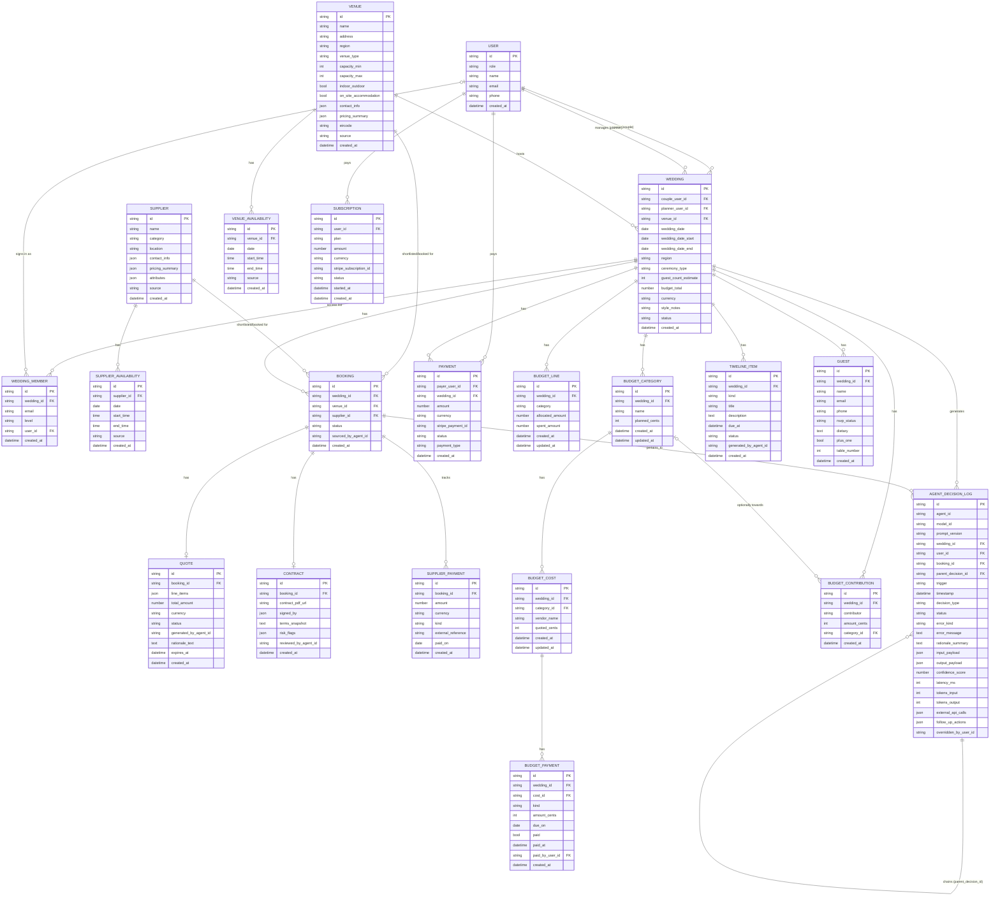

# VenueFlow — ERD & Data Model (MVP, AI Wedding Coordinator)

This model supports the AI Wedding Coordinator product (see [CLAUDE.md](../CLAUDE.md)). The agent does what a human wedding planner does: source venues + suppliers, draft timelines, track budget, review contracts, manage RSVPs/seating, and run day-of logistics. Customers are **couples** (one-time coordinator fee per wedding) and **independent wedding planners** (monthly subscription, manage multiple client weddings).

## Entities

### Identity & billing

- **WeddingMember** — the access list (PD-002). One row per wedding and email (unique together); `level` ∈ `{viewer, editor, owner}`. `user_id` is filled in when that person first signs in with a verified email. The wedding's creator is added as owner. Migration `0002` also backfills each existing `couple_user_id` as owner.
- **User** — `role` is `couple` for everyone since PD-003 (the planner and admin roles were removed; older rows may still hold them, and the API ignores role for access). The old `venue_admin` role is removed: VenueFlow is not sold to venues.
- **Subscription** — *unused since PD-003, table kept empty.* Recurring billing for planners (€199–€499/mo plans). One active subscription per planner user.
- **Payment** — *unused since PD-003, table kept empty.* One-time charges VenueFlow collected via Stripe. `payment_type` ∈ `{coordinator_fee, planner_setup, other}`. Coordinator fees (couples, €299–€999) are the primary one-time revenue stream.

### Core wedding object

- **Wedding** — the central object. `couple_user_id` required; `planner_user_id` optional (set when a planner manages it). `venue_id` is a denormalized convenience FK to the chosen venue — it mirrors the Booking with `venue_id IS NOT NULL AND status='booked'`. `status` ∈ `{intake, planning, booked, completed, cancelled}` (intake = being planned by the agent, planning = budget and timeline ready, booked = venue locked; PD-003 removed the payment stage). `wedding_date` is nullable; if not set, planning uses the date range defined by `wedding_date_start` and `wedding_date_end`. `region` specifies the target wedding location. `ceremony_type` determines the cultural budgeting and timeline template.
- **BudgetLine** — one row per category per wedding (`venue, catering, florals, photography, videography, music, dj, officiant, stationery, hair_makeup, transport, cake, other`). `spent_amount` is recomputed from accepted Quotes + SupplierPayments.
- **Budget (PD-004)** — the couple's own budget screen, separate from the intake planner's `BudgetLine` rows (left as they were: float EUR amounts). Every amount is whole US cents. `Wedding.budget_total_cents` is the couple's optional total (blank until they set it; not taken from the intake `budget_total`). **BudgetCategory** has a name and optional `planned_cents`. **BudgetCost** is a vendor cost under a category: free-text `vendor_name` and optional `quoted_cents`. **BudgetPayment** is a deposit or later payment on a cost, with an optional `due_on`; `paid`, `paid_at` and `paid_by_user_id` change only when a signed-in owner or editor ticks it (rule 4). **BudgetContribution** records who is contributing (a free-text label) and how much, optionally towards one category. "Committed" for a cost is its quote, or the sum of its payments if there's no quote; "still to pay" is committed minus paid. Removing a category removes its costs and payments; contributions towards it stay, untied.
- **TimelineItem** — `kind` ∈ `{planning, day_of}`. Planning items have a future `due_at`; day-of items use the wedding date + time-of-day. One table to keep the agent's "draft + update timeline" decisions uniform.
- **Guest** — RSVP + seating. `table_number` is set by the agent's seating-assign decision and can be overridden by the couple/planner.

### Venues and suppliers (sourced, not customers)

- **Venue** — kept as a first-class entity because the chosen venue is the anchor decision for every wedding and has venue-specific attributes (capacity, indoor/outdoor, on-site accommodation, region). `venue_type` covers the mixed-use angle from [README](../README.md) §3.4: `country_house | hotel | community_hall | gaa_clubhouse | church | farm | restaurant | other`. `source` ∈ `{manual, partner, scraped, couple_submitted}`. `eircode` is a derived geocoding key (extracted from `address` via `constants.extract_eircode`, nullable) powering the Google Maps view on the frontend; the full `address` remains the source of truth, and Northern Irish venues resolve to `null` (UK postcode, not an eircode) and geocode from `address` instead.
- **Supplier** — every non-venue vendor (catering, florals, photo, video, music, etc.). `category` drives matching. `attributes` (JSON) holds category-specific fields (e.g., photographer's style tags).
- **VenueAvailability / SupplierAvailability** — split into two tables (rather than one polymorphic table) to avoid a XOR constraint and to keep indexing simple.

### Booking funnel

- **Booking** — one row per (wedding × venue) or (wedding × supplier) intent. Polymorphic: exactly one of `venue_id` or `supplier_id` is set (XOR — enforce in app + DB check constraint). `status` ∈ `{shortlisted, inquired, quoted, booked, declined, cancelled}`. `sourced_by_agent_id` records which agent surfaced the option (XPRIZE-critical: proves agent participation in sourcing).
- **Quote** — what a venue/supplier quoted for a booking. `status` ∈ `{pending, accepted, declined, expired}`. `generated_by_agent_id` is set when the agent drafted or negotiated it (vs. transcribed from a supplier email).
- **Contract** — PDF + terms snapshot. `risk_flags` (JSON) holds the agent's contract-review output (e.g., `[{clause: "deposit_nonrefundable", severity: "high", note: "..."}]`). `reviewed_by_agent_id` records which agent did the review.
- **SupplierPayment** — **tracking only**, not collected by VenueFlow. Per the chosen flow, couples pay venues/suppliers directly; VenueFlow records the deposit/balance for budget tracking and run-of-show readiness. `kind` ∈ `{deposit, balance, additional}`. `external_reference` is a free-text receipt id (couple-supplied or supplier-confirmed).

### Agent decision log (XPRIZE-critical)

- **AgentDecisionLog** — every autonomous agent action. This is the artifact the XPRIZE judges will export and inspect, so the schema is intentionally richer than the other entities.
  - **Identity & versioning.** `agent_id` is the *logical* agent (e.g., `venue_matcher`, `contract_reviewer`), not a per-call run id. `model_id` is the underlying LLM identifier (e.g., `gemini-3-pro-2026-04`). `prompt_version` is the team's own prompt-template version (e.g., `v3.1`). Together these make every decision reproducible and let prompt iteration be audited.
  - **Decision taxonomy.** `decision_type` vocabulary (extend as needed): `venue_match, supplier_match, inquiry_draft, quote_draft, quote_negotiate, contract_review, timeline_generate, timeline_update, budget_alert, budget_split, rsvp_followup, seating_assign, runofshow_update, followup_scheduled, reschedule, post_event_review_request`.
  - **Status.** `status` ∈ `{success, error, blocked_by_guardrail, overridden}`. Errors are also production reality — log them. `error_kind` is a short code (`schema_violation`, `upstream_timeout`, `rate_limited`, `guardrail_blocked`, …); `error_message` is free text.
  - **Chains & triggers.** `trigger` ∈ `{couple_action, planner_action, supplier_response, scheduled, parent_decision, agent_initiated}`. `parent_decision_id` is a self-FK so chains of reasoning (e.g., `contract_review → flag_risk → notify_couple`) are queryable as a DAG rather than appearing as isolated point events.
  - **Rationale.** `rationale_summary` is a short human-readable sentence ("Shortlisted Five Mile Stables — matches 120-guest indoor/outdoor brief, confirmed Aug 2026 availability, €5,200 within budget"). It powers the couple-facing override UI and gives skimming judges a story. The full structured reasoning still lives in `output_payload`.
  - **Production metering.** `latency_ms`, `tokens_input`, `tokens_output`, `external_api_calls` (JSON list of `{provider, endpoint, ts_start, ts_end, status, response_bytes}`). Cost is *derived at export time* from tokens × model pricing — no `cost_*` column.
  - **Confidence.** `confidence_score` is a float in `[0, 1]`. Reserve `null` for decisions where the agent can't self-estimate (e.g., deterministic post-processing wrapped as a "decision" for log completeness).
  - **Follow-ups.** `follow_up_actions` is a JSON list of scheduled follow-ups not yet executed (e.g., `{kind: rsvp_reminder, due_at: 2026-08-15T09:00Z, payload: {…}}`). Once executed, each becomes its own `AgentDecisionLog` row with `parent_decision_id` pointing back here.
  - **Override audit.** `overridden_by_user_id` set when a human override is recorded (see user story 8). The replacement output and the reason are captured on the override's own log entry, not on the original.
  - **Export & redaction.** Full rows are exportable as CSV. PII redaction (couple addresses, supplier private contacts, contract terms) happens at the *export pipeline*, not as a column on this table.

## Notes

- **Payments split.** `PAYMENT` = VenueFlow revenue (coordinator fees, one-off charges). `SUBSCRIPTION` = planner recurring. `SUPPLIER_PAYMENT` = tracking-only records of money the couple paid venues/suppliers directly. Keeping these separate avoids overloading a single table with three different lifecycles.
- **Polymorphic Booking.** The XOR (`venue_id` or `supplier_id`, not both, not neither) is the one place enforcement matters most. Use a DB check constraint and a runtime guard.
- **JSON-shaped fields** (`line_items`, `risk_flags`, `attributes`, `*_payload`, `external_api_calls`, `follow_up_actions`, `contact_info`, `pricing_summary`) are deliberately not normalized for Day-90. Promote to columns/tables only when a query pattern demands it.
- **AgentDecisionLog is the submission artifact.** Anything the agent does autonomously — including drafting supplier inquiry messages and negotiating quotes — must land here with `input_payload`, `output_payload`, `confidence_score`, and `external_api_calls`. There is no separate Message/Communication entity in the MVP; supplier-facing drafts live in `output_payload`.
- **Venue is denormalized on Wedding.** `WEDDING.venue_id` mirrors the booked-venue Booking. Two writes when a venue is booked (Booking.status → `booked`, Wedding.venue_id ← that venue). Worth the denormalization because the wedding's venue is referenced on almost every other entity's queries (run-of-show, invites, supplier coordination).
