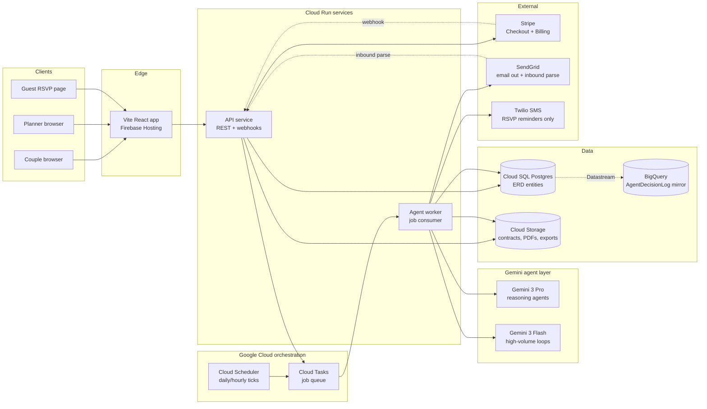
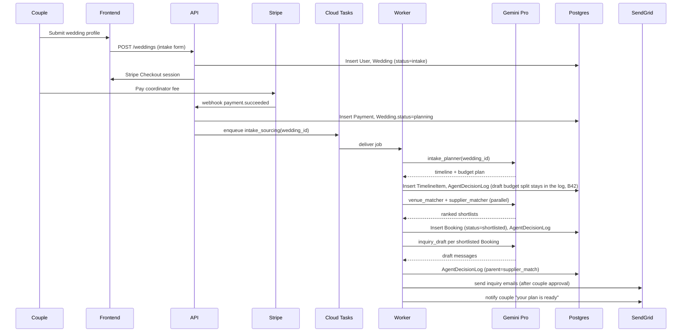
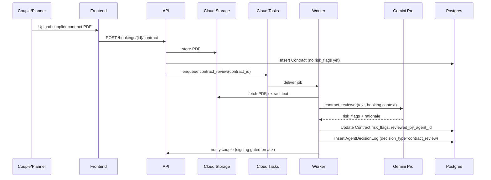
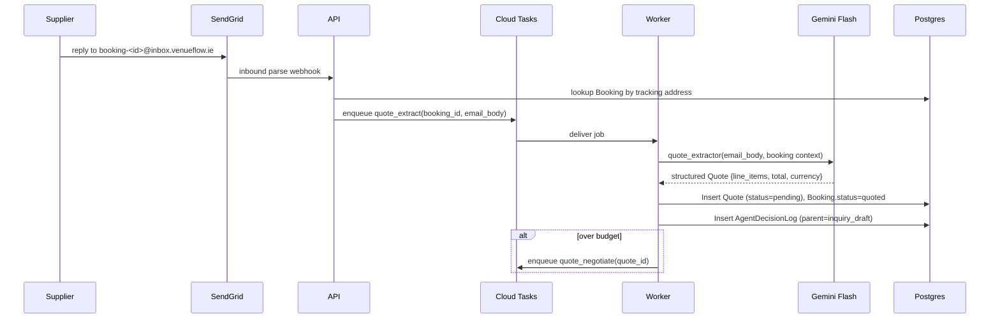

# VenueFlow — Architecture (MVP, AI Wedding Coordinator)

> [!NOTE]
> **Implementation Status**:
> - **Current Implementation**: A Vite + React frontend communicating with a **FastAPI backend** over REST endpoints. Database schemas are managed using **SQLModel** with SQLite for local development, and Postgres ready. Asynchronous agent task execution uses a Google Cloud Tasks structure, with a local Tasks Emulator and direct background invocation fallback for development.
> - **Planned Infrastructure**: Deployment to GCP Cloud Run, Cloud Tasks, Cloud Scheduler, Cloud SQL Postgres, SendGrid parse webhook, Twilio SMS, and Firebase Auth. Some third-party integrations (like full Firebase Auth, Twilio SMS sending, SendGrid parse webhooks) are mocked/simulated in the development environment.

Constraints driving the picks:
- **XPRIZE rule:** must use Gemini + at least one Google Cloud product. The picks below satisfy this several times over.
- **Day-90 budget:** small team, fixed deadline. Default to managed services and boring choices.
- **`AgentDecisionLog` is the submission artifact.** Every agent invocation writes one row. This shapes the agent layer's invocation contract.

## Service map

## Stack choices

### Database — Cloud SQL Postgres (not Firestore)

The ERD is heavily relational: polymorphic `Booking`, planner-multi-wedding joins, `AgentDecisionLog` filtered by `decision_type` × `status` × `wedding_id`. Firestore would mean denormalizing aggressively or doing joins in app code — both burn Day-90 budget. Postgres on Cloud SQL is the honest fit, ships row-level security for couple/planner data isolation, and gives us proper check constraints for the polymorphic `Booking` XOR.

Firebase is still used for Auth and Hosting (no migration pain there), but data lives in Postgres.

### Agent orchestration — Cloud Run + Cloud Tasks + Cloud Scheduler (Antigravity as a week-1 spike)

Default to a stack we can debug: API service on Cloud Run, async work via Cloud Tasks, recurring sweeps via Cloud Scheduler. Worker is a separate Cloud Run service consuming the queue — clean scaling, separate cold-start profile from the API.

Antigravity Managed Agents may earn its place if its built-in tracing, retries, and agent-state checkpoints meaningfully beat what we'd build on top of Cloud Tasks. Decide after a one-week spike. The sponsor-stack narrative win is real but not worth a week of debugging an unfamiliar runtime if it doesn't fit.

### Voice — out for MVP

The original venue-receptionist plan had Gemini Flash voice + Twilio voice. The coordinator pivot doesn't need it: couples and planners interact via chat/web/email. Twilio stays in the stack for **outbound SMS only** (RSVP reminders, day-of nudges). Cutting inbound voice removes the highest-risk hallucination surface — the live-voice quoting failure mode flagged in [README.md](../README.md) §1.3.

### Supplier reply ingestion — SendGrid inbound parse + Gemini Flash extractor

The agent drafts inquiry emails to suppliers, but suppliers reply in prose. Without an ingestion path the quote funnel stalls. SendGrid inbound parse webhook → API matches the reply to a `Booking` via a tracking address (`booking-<id>@inbox.venueflow.ie`) → enqueue a parse job → Gemini Flash extracts a structured quote → write `Quote` row + `AgentDecisionLog` with `parent_decision_id` linking to the original `inquiry_draft`.

### Payments — removed

The app takes no payments (PD-003). The Stripe Checkout and Billing code, the payment gate and the mock checkout were removed. Supplier deposits are still tracked only: couples pay suppliers directly (`SUPPLIER_PAYMENT`). The diagram and flows below still show the old Stripe path; they're historical.

### Auth — Firebase Auth

Personal sign-in through the couple's own Firebase project (PD-002): Google, with email and password as a fallback. A password account is let in only once its email is confirmed; the person asks Firebase for the confirmation email with their own click (`sendEmailVerification`), and the app never sends it. There's no self sign-up. A new account is created only for a verified email on the wedding's access list (`wedding_members`), or in `ACCESS_BOOTSTRAP_EMAILS`, the couple's own emails. Those are the only ones that may create the wedding, and both become owners. Access levels (viewer, editor, owner) are enforced in the API (`app/api/v1/access.py`), not in Postgres. Only owners can read or change the access list (`endpoints/members.py`, the **Who has access** screen). They add people as editor or viewer. Owner rows can't be removed or changed through the API or the screen, not even your own; the team changes them with `manage_access.py` on the couple's request (PD-002 note, 2026-11-05). Adding someone sends nothing. Worker `/tasks/*` routes need `X-Internal-Token: INTERNAL_TASKS_SECRET`, and the inbound-email webhook needs `?token=INBOUND_EMAIL_SECRET`. Outside `DEVELOPMENT_MODE`, both refuse every call when their secret isn't set. The SaaS-era planner sign-in and roles were removed (PD-003).

### Frontend hosting — Firebase Hosting

Already wired to the build output of the Vite app in [frontend/](../frontend/). Keep it.

### Storage — Cloud Storage

Contract PDFs, exported submission ZIPs, agent-generated artifacts (e.g., run-of-show PDF). Lifecycle rules for old exports.

### Analytics + submission export — BigQuery

`AgentDecisionLog` lives in Postgres for transactional consistency, mirrored to BigQuery via Datastream. The XPRIZE CSV export and the MRR/agent-activity dashboard read from BigQuery, not the OLTP DB. Keeps long-running OLAP queries off the path of live agent writes.

### Secrets — Secret Manager

Stripe, Gemini, SendGrid, Twilio keys. Mounted as env vars at Cloud Run deploy time.

## Agent layer

Every agent is a function: `(input_payload) → (output_payload, AgentDecisionLog row)`. The Worker is the only thing that calls Gemini directly; the API enqueues jobs and reads results. This gives one place to enforce the invocation contract.

### Invocation contract

Every agent call must:
1. Open an `AgentDecisionLog` row with `status='pending'` before the Gemini call.
2. Record `model_id`, `prompt_version`, `agent_id`, `trigger`, `parent_decision_id` (if chained), `input_payload`.
3. Call Gemini, capturing `latency_ms`, `tokens_input`, `tokens_output`, and any `external_api_calls`.
4. Validate the output against the agent's output schema (Zod/Pydantic). Schema failure → `status='error'`, `error_kind='schema_violation'`.
5. Apply guardrails (price ceilings, PII filters, hallucination checks). Block → `status='blocked_by_guardrail'`.
6. On success: write `output_payload`, `rationale_summary`, `confidence_score`; mutate domain entities (`Booking`, `Contract`, etc.) in the same DB transaction. Flip `status='success'`.
7. Enqueue any `follow_up_actions`.

This logic lives in a single `runAgent()` helper. Agents themselves are just `{ name, model, promptTemplate, outputSchema, guardrails, mutate }` configs.

### Agent inventory

| Agent | Model | Trigger | `decision_type` writes | Story |
|---|---|---|---|---|
| `intake_planner` | Pro | Stripe webhook → `Wedding.status=planning` | `timeline_generate`, `budget_alert` (seed) | 1, 2 |
| `venue_matcher` | Pro | Wedding planning starts | `venue_match`, then N `inquiry_draft` | 4 |
| `supplier_matcher` | Pro | Same as above, per category | `supplier_match`, `inquiry_draft` | 4 |
| `quote_extractor` | Flash | SendGrid inbound parse | `quote_draft` (chained to `inquiry_draft`) | 4 |
| `quote_negotiator` | Pro | Quote extracted, over budget | `quote_negotiate` | 4, 9 |
| `contract_reviewer` | Pro | Contract uploaded to GCS | `contract_review` | 5 |
| `budget_monitor` | Flash | `Quote.status='accepted'` or `SupplierPayment` insert | `budget_alert` | 9 |
| `budget_splitter` | Flash | Couple action ("Suggest a starting split", needs a total) | `budget_split`. Returns percentage shares only; amounts are worked out in cents from the couple's total. Saves nothing; the couple apply it themselves. Blocks on unknown or duplicate categories (compared ignoring case, spaces and underscores), bad shares, shares not adding to 100%, or amounts not adding to the total. Blanks any reason that states a price. Applying needs the lines to add up to the total | PD-004 |
| `rsvp_follower` | Flash | Cloud Scheduler daily | `rsvp_followup` | 10 |
| `seating_assigner` | Pro | Couple action ("draft seating") | `seating_assign` | 11 |
| `runofshow_updater` | Pro | `Booking`/`Quote` change near wedding date | `timeline_update`, `runofshow_update` | 12 |
| `reschedule_handler` | Pro | Supplier cancellation event | `reschedule` | cross-cutting |
| `post_event_followup` | Flash | Cloud Scheduler post-wedding | `post_event_review_request` | P2 |

Gemini 3 Pro for anything that reasons over structured context (matching, review, negotiation, planning). Gemini 3 Flash for high-volume drafting and extraction where Pro is overkill.

## Key flows

### Couple intake → initial sourcing

### Contract upload → review

### Supplier reply → quote extraction

RSVP follow-ups follow the same shape but triggered by Cloud Scheduler instead of a webhook: scheduler hits an API endpoint that lists weddings needing nudges and enqueues one job per guest cohort.

## Deferred / out of MVP

- **Stripe Connect / passthrough payments** — couples pay suppliers directly per chosen flow.
- **Inbound voice (Twilio Voice + Gemini live voice)** — coordinator product doesn't need it; cuts the biggest hallucination surface.
- **Multi-tenant planner branding (white-label)** — planner B2B story is "use the agent to scale your practice," not "rebrand it." Defer.
- **Mobile apps** — web responsive only.
- **Real-time collaboration on planning docs** — couples + planners can both edit, but no live cursors / OT. Optimistic last-writer-wins is fine.
- **Vendor marketplace / supplier accounts** — suppliers are sourced and contacted, not customers. No supplier login in MVP.

## Open questions

- **Antigravity vs. hand-rolled orchestrator.** Resolve via week-1 spike. The invocation contract above is portable either way.
- **BigQuery mirror cadence.** Datastream gives sub-minute lag; whether that's needed for the live dashboard or whether a 5-minute scheduled export suffices is unclear until traffic exists.
- **Guardrails authoring.** Per-agent guardrail configs (price ceilings, PII redaction, "don't promise availability without DB lookup") need an owner. Probably the prompt-engineering surface area expands fastest in weeks 4–8.
